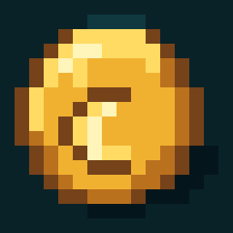
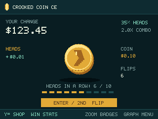
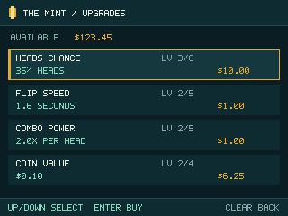

# Crooked Coin CE



A native TI-84 Plus CE adaptation of **[Unfair Flips](https://store.steampowered.com/app/3925760/Unfair_Flips/)** by Heather Flowers. Flip a stubborn coin, buy upgrades, chase ten consecutive heads, and discover five endings.

Original pixel art, gold and dark teal colors, a readable 320×240 interface, and an economy checked against an owned PC installation.

**Preview release:** native compilation and host tests pass. Physical-calculator and CEmu execution have **not** been verified. This is an independent fan adaptation, with the specific differences listed in [the parity checklist](docs/PARITY.md).




These screenshots come from the actual C renderer on a host computer, using labeled setup fixtures. They are not calculator or emulator captures.

## Download and install

Get `CROOKED.8xp` or the calculator ZIP from the [v0.1.1 preview release](https://github.com/silo555/crooked-coin-ce/releases/tag/v0.1.1). The repository and release remain private until the owner approves public visibility.

1. Install the official [CE libraries v15.0](https://github.com/CE-Programming/libraries/releases/tag/v15.0), normally by transferring `clibs.8xg` with [TI Connect CE](https://education.ti.com/en/products/computer-software/ti-connect-ce-sw). Already installed compatible libraries can be reused.
2. Transfer `CROOKED.8xp` to **Archive** on a TI-84 Plus CE or TI-84 Plus CE Python.
3. Launch `CROOKED` using your working native launcher, such as [Cesium](https://github.com/mateoconlechuga/cesium). Newer OS versions require an appropriate native-program launch setup; see [installation details](docs/INSTALL.md).

The calculator variable is `CROOKED`. A compatible shell shows the 16×16 icon and description **Crooked Coin CE**; the underlying variable name cannot contain spaces.

## Controls

| Key | Action |
| --- | --- |
| ENTER / 2nd | Flip; buy selected upgrade; confirm |
| Y= | Shop, including while a coin is airborne |
| WINDOW | Statistics and recent history |
| ZOOM | Local achievements |
| TRACE | Handbook / original adaptation notes |
| GRAPH / MODE | Settings, profile, restart, save and quit |
| Arrows | Navigate; left/right changes history/statistics pages |
| CLEAR | Back/cancel; from play opens the menu |
| ALPHA | An original cosmetic fish toggle |

Hold-to-flip and autoplay are absent, as in the inspected PC build. Press and release to flip again. Restarting a run, changing commentary mode, erasing progress, and quitting after a failed save all require confirmation where progress would be lost.

## What's here

- All four upgrade categories and all 22 purchases, with the PC prices, caps, denominations, and payout order.
- Heads chance sampled at launch; live shop purchases can affect landing time and payout.
- All five ending branches and 14 local badges that survive new runs.
- Thirteen recent result/tutorial/upgrade messages; all 35 standard tutorial trigger counts, with original writing.
- Separate standard/April progress profiles, original alternate presentation, reduced motion, and lifetime statistics.
- Two alternating, versioned, CRC-protected save AppVars with readback verification and recovery screens.

Steam services, PC audio, commercial assets, the original commentary essays, and a cross-game cosmetic are documented adaptations or exclusions. The April executable itself was not available for local inspection. See [PARITY.md](docs/PARITY.md) before interpreting this as complete PC parity.

## Source, builds, and tests

Build with [CEdev v15.0](https://github.com/CE-Programming/toolchain/releases/tag/v15.0):

```sh
make
python3 tools/verify_8xp.py bin/CROOKED.8xp --icon-asm obj/icon.s
```

Run the actual engine, UI, and save tests on a host compiler:

```sh
CC=clang python3 tools/run_tests.py --sanitize
python3 tools/make_icon.py --check
```

Try the same C code interactively on your computer:

```sh
python3 preview/run.py --cc clang
```

Open `http://127.0.0.1:8766`. This preview has session-only progress and does not test the calculator backend. Details: [build guide](docs/BUILDING.md), [testing and limits](docs/TESTING.md), [save format](docs/SAVES.md), [credits](CREDITS.md).

The [GitHub workflow](.github/workflows/ci.yml) runs host sanitizers, validates icon generation, builds a real `.8xp` with a pinned official toolchain, and verifies its TI transfer format. See the release notes for the verified run. No game installation or ROM is needed to build or test the public source.

## License

Original Crooked Coin CE source, art, and writing are under the [MIT license](LICENSE). Unfair Flips and its commercial content belong to their respective owners and are not included. Please support [the original game](https://store.steampowered.com/app/3925760/Unfair_Flips/).
